# E-Commerce Platform (Olist) Data Lakehouse

<p align="center">
  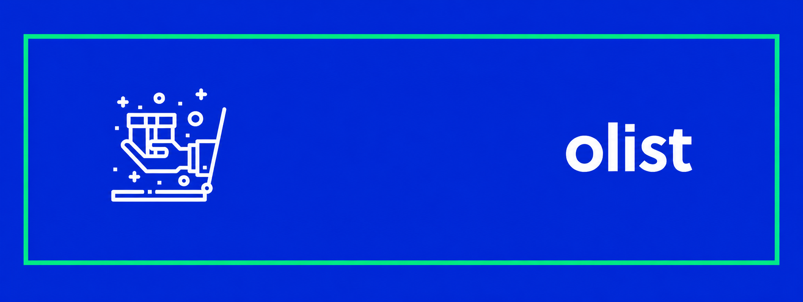
</p>

<p align="center">
  
  
  
  
  
</p>

An end-to-end data lakehouse for the [Olist Brazilian E-Commerce dataset](https://www.kaggle.com/datasets/olistbr/brazilian-ecommerce). The project uses PySpark to transform 100,000+ e-commerce orders into governed, analytics-ready Parquet tables. Curated Gold data can then be served through Amazon S3, AWS Glue Data Catalog, Amazon Athena, and Power BI.

The design follows Medallion architecture. Source CSV files are retained in Raw, converted to Bronze Parquet, cleaned in Silver, and shaped into Gold facts and dimensions. Transformations run locally; only optimized Gold datasets are published to AWS. This keeps the cloud serving layer lightweight: Athena queries files in S3 without a database server or AWS Glue ETL jobs.

## Contents

- [What this project delivers](#what-this-project-delivers)
- [Architecture](#architecture)
- [How the pipeline works](#how-the-pipeline-works)
- [Gold data model](#gold-data-model)
- [Run locally](#run-locally)
- [Publish and query in AWS](#publish-and-query-in-aws)
- [Data quality](#data-quality)
- [Power BI dashboard](#power-bi-dashboard)
- [Repository layout](#repository-layout)

## What this project delivers

| Capability | Outcome |
| --- | --- |
| Repeatable ingestion | Local Olist CSV files are converted into Snappy-compressed Parquet, with an ingestion timestamp. |
| Layered data quality | Bronze preserves source structure, Silver standardizes and validates records, and Gold provides reporting-ready tables. |
| Analytics model | A seven-table star schema supports revenue, orders, products, sellers, payments, reviews, delivery, and geography analysis. |
| Quality gate | `pytest` checks run after Gold modeling and before business analytics are generated. |
| Cloud SQL serving | Gold data can be uploaded to S3, cataloged in Glue, and queried in Athena. |
| Business intelligence | A Power BI semantic model and three dashboard pages consume the Gold model. |

## Architecture

The system intentionally separates compute from serving. PySpark performs the work locally, while AWS stores and queries the final curated data.

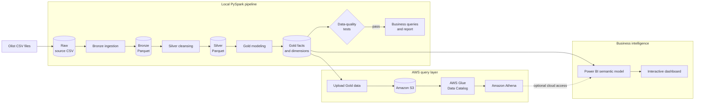

### End-to-end flow

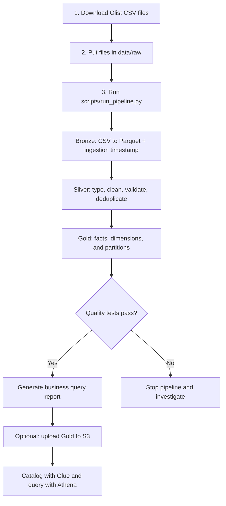

### Local orchestration

`scripts/run_pipeline.py` executes each stage in dependency order and exits immediately if a command fails. This prevents analytics from being generated from an incomplete or invalid layer.

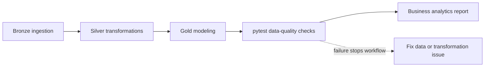

## How the pipeline works

### Medallion layers

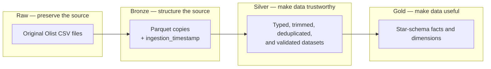

| Layer | Purpose | What happens in this project |
| --- | --- | --- |
| **Raw** | Preserve the supplied source files. | Original Olist CSV files live in `data/raw/` and are not modified by the pipeline. |
| **Bronze** | Create a reliable, efficient first copy. | Every CSV is read with Spark, including multiline reviews, then written as Snappy Parquet with `ingestion_timestamp`. |
| **Silver** | Conform and validate source records. | Timestamps are cast, selected text is standardized, duplicates are removed, and invalid prices, freight, and payments are excluded. |
| **Gold** | Provide a business-friendly analytics model. | Dimensions and facts are written as Parquet; `fact_orders` is partitioned by purchase year and month. |

### Silver cleansing rules

The Silver layer makes explicit the quality assumptions used by downstream reporting:

- `orders`: date columns are converted to timestamps and duplicate `order_id` values are removed.
- `order_items`: duplicate `(order_id, order_item_id)` rows are removed; price must be positive and freight cannot be negative.
- `payments`: duplicate rows are removed and `payment_value` must be positive.
- `customers`: duplicate `customer_id` values are removed; city values are trimmed and lowercased.
- Products, sellers, reviews, and category translations are deduplicated using their relevant keys or complete records.
- Geolocation is passed through because repeated coordinates are meaningful for density analysis.

### Gold modeling and partitioning

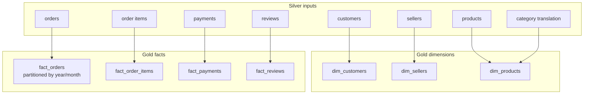

`fact_orders` is stored under `purchase_year` and `purchase_month` partitions. When an Athena query filters on both fields, Athena can read only the relevant folders instead of scanning the full table.

## Gold data model

The Gold layer separates descriptive entities from measurable events. This star-schema style model makes common dashboard measures easier to calculate and explain.

| Type | Table | Role |
| --- | --- | --- |
| Dimension | `dim_customers` | Customer identity and location attributes. |
| Dimension | `dim_sellers` | Seller identity and location attributes. |
| Dimension | `dim_products` | Product properties and English product category. |
| Fact | `fact_orders` | Order lifecycle and purchase-date attributes. |
| Fact | `fact_order_items` | Order line items, product, seller, price, and freight. |
| Fact | `fact_payments` | Payment method, installments, and payment value. |
| Fact | `fact_reviews` | Review score and review timestamps. |

### Relationship subdiagram

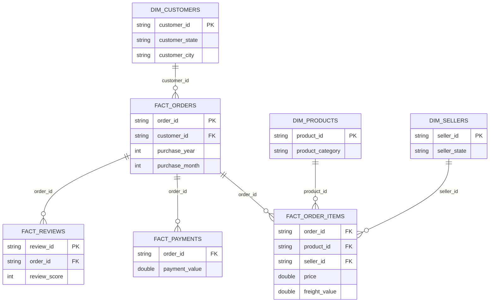

This model supports monthly revenue, average order value (AOV), order growth, fulfillment and delivery performance, category and seller performance, payment behavior, reviews, and regional order volume.

## Technology stack

| Area | Technology | Responsibility |
| --- | --- | --- |
| Data processing | Python and PySpark 3.5.0 | Ingestion, transformations, and local analysis. |
| Storage format | Snappy-compressed Parquet | Efficient, columnar storage for Bronze through Gold layers. |
| Quality assurance | `pytest` | Gold-layer integrity checks. |
| Data lake and metadata | Amazon S3 and AWS Glue Data Catalog | Gold data storage and table metadata. |
| Serverless SQL | Amazon Athena | SQL directly against Gold Parquet in S3. |
| BI | Power BI and DAX | Semantic model, measures, and interactive reporting. |
| Orchestration | Python `subprocess` controller | Ordered, fail-fast execution of pipeline stages. |

## Run locally

### Prerequisites

- Python 3.9 or later.
- A Java runtime compatible with PySpark.
- The Olist dataset CSV files downloaded from [Kaggle](https://www.kaggle.com/datasets/olistbr/brazilian-ecommerce).

The dataset itself is intentionally not versioned in this repository.

### Install and prepare data

```powershell
git clone https://github.com/YOUR_USERNAME/ecommerce-data-lakehouse.git
cd ecommerce-data-lakehouse
python -m venv venv
.\venv\Scripts\Activate.ps1
pip install -r requirements.txt
```

Place the downloaded CSV files directly in `data/raw/`. The pipeline discovers every `.csv` file in that directory; the standard Olist download contains the datasets used by the downstream transformations.

### Run the complete pipeline

```powershell
python scripts/run_pipeline.py
```

On success, the pipeline creates local Bronze, Silver, and Gold outputs under `data/` and writes the analytics results to `docs/business_queries_report.txt`.

### Run an individual stage

Use individual commands while developing or troubleshooting:

```powershell
python src/ingestion/ingest_to_bronze.py
python src/transformations/process_silver.py
python src/transformations/process_gold.py
python -m pytest tests/test_data_quality.py -v --disable-warnings
python src/analytics/business_queries.py
```

## Publish and query in AWS

The cloud deployment publishes only Gold outputs. This avoids using AWS Glue ETL for transformations; Athena then provides on-demand SQL over the Parquet files in S3. Athena costs, if any, depend on data scanned by queries.

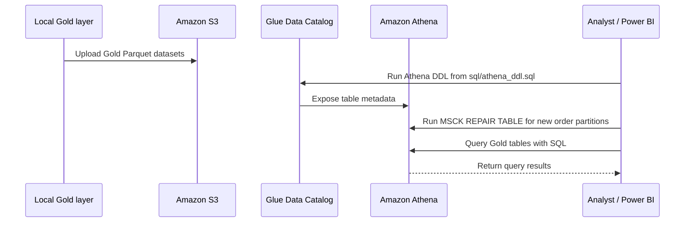

1. Upload Gold Parquet data to `s3://ritam-ecommerce-lakehouse-gold` in `ap-southeast-2`, using `scripts/upload_to_s3.py`.
2. Run [sql/athena_ddl.sql](sql/athena_ddl.sql) to create the `ecommerce_gold` database and external table definitions.
3. After uploading new `fact_orders` partitions, run:

   ```sql
   MSCK REPAIR TABLE ecommerce_gold.fact_orders;
   ```

4. Filter Athena queries by `purchase_year` and `purchase_month` whenever practical to take advantage of partition pruning.

### Proof of cloud execution

<p align="center">
  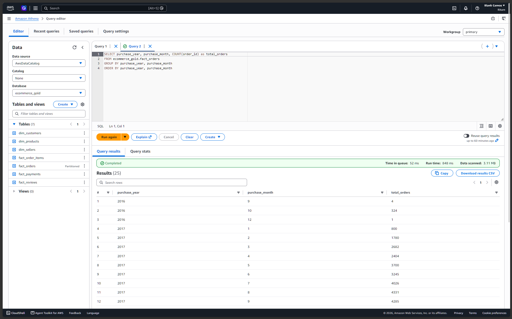
  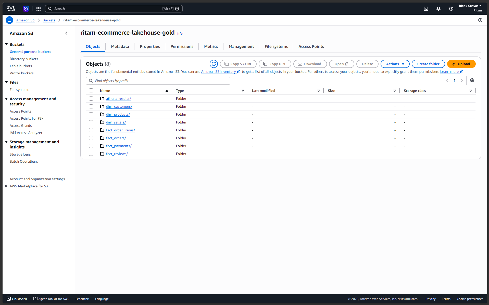
</p>

## Data quality

Data-quality tests form a gate between Gold modeling and analytics. They make reporting assumptions executable rather than implicit.

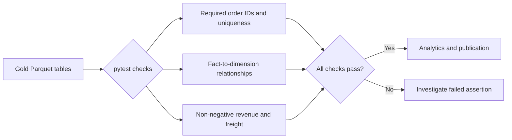

The test suite checks:

- Non-null and unique `order_id` values in `fact_orders`.
- Referential integrity between `fact_orders` and `dim_customers`, using a left anti-join to surface orphaned keys.
- Non-negative revenue-related and freight values.
- Review scores restricted to whole-number values from 1 through 5.
- Repeatable local execution through `pytest`.

These tests do not replace source-system governance, but they prevent a known set of invalid conditions from reaching downstream analytics.

## Power BI dashboard

Power BI batch-loads the seven local Gold Parquet tables through the **Folder** connector. In Power Query, the `Extension` column is filtered to remove hidden `.crc` files and blank values before the Parquet binaries are combined.

The report uses `fact_orders` as the central hub of its one-to-many model. For map visuals, `dim_customers` includes this calculated column:

```DAX
State Location = dim_customers[customer_state] & ", Brazil"
```

### Core measures

```DAX
Total Orders = DISTINCTCOUNT(fact_orders[order_id])
Total Revenue = SUM(fact_payments[payment_value])
Average Order Value = [Total Revenue] / [Total Orders]
Average Review Score = AVERAGE(fact_reviews[review_score])
Average Freight = AVERAGE(fact_order_items[freight_value])
Product Revenue = SUM(fact_order_items[price])
Items Sold = COUNT(fact_order_items[order_item_id])
Total Reviews = COUNT(fact_reviews[review_id])
Delivery Time (Days) = AVERAGEX(fact_orders, DATEDIFF(fact_orders[order_approved_at], fact_orders[order_delivered_customer_date], DAY))
```

### Dashboard navigation

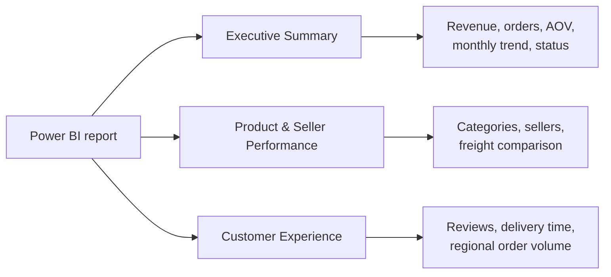

#### Executive Summary

- KPI cards for Total Revenue, Total Orders, and Average Order Value.
- Monthly Revenue Trend by purchase year and month; incomplete September 2018 data is excluded.
- Order Fulfillment Status donut chart and date slicers.

<p align="center">
  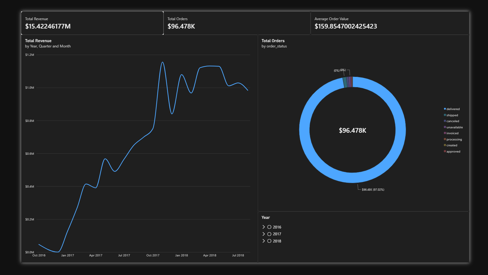
</p>

#### Product & Seller Performance

- Top 10 categories by Product Revenue.
- Seller matrix with revenue and items sold.
- Product Revenue versus Average Freight scatter plot, grouped by category.
- Product Category slicer.

<p align="center">
  
</p>

#### Customer Experience

- KPI cards for Average Review Score and Delivery Time (Days).
- Regional order-volume map using `State Location`.
- Delivery-time analysis by customer state and review-score distribution.

<p align="center">
  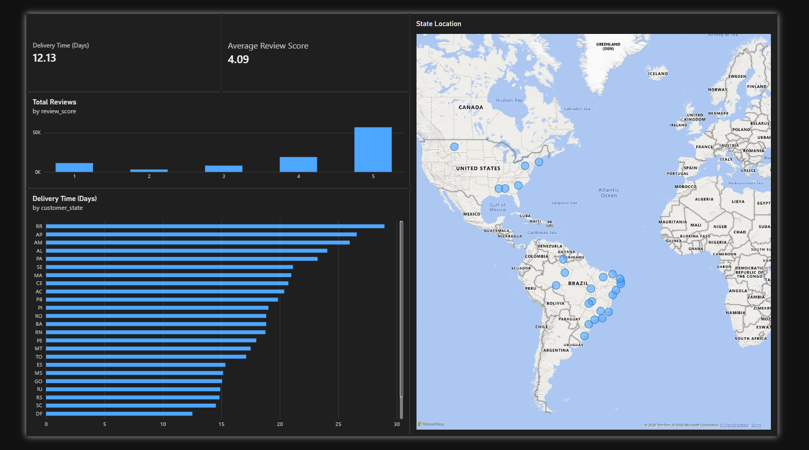
</p>

## Repository Layout

```text
ecommerce-data-lakehouse/
├── config/                 # Shared path configuration
├── data/                   # Local Raw, Bronze, Silver, and Gold data (Gitignored)
├── dashboards/             # Power BI project, semantic model, and report definition
├── docs/                   # Generated analytics report and documentation images
├── scripts/                # Pipeline controller and S3 upload utility
├── sql/                    # Athena external-table DDL
├── src/
│   ├── analytics/          # Spark SQL business queries
│   ├── ingestion/          # CSV-to-Bronze ingestion
│   └── transformations/    # Silver cleansing and Gold modeling
└── tests/                  # Pytest data-quality assertions
```

## Key Concepts & Technologies used

| Concept | Meaning (here) |
| --- | --- |
| **Data lakehouse** | File-based, low-cost storage paired with governed Parquet tables and SQL/BI access. |
| **Medallion architecture** | A progression from preserved source data to cleaned data to business-facing models. |
| **Parquet** | Compressed, column-oriented analytics storage used for Bronze, Silver, and Gold. |
| **Star schema** | A central set of facts connected to descriptive dimensions for straightforward reporting. |
| **Partitioning** | Folder-based organization of `fact_orders` by purchase year and month to reduce Athena scan volume. |
| **AWS Glue Data Catalog** | Metadata that tells Athena a table's schema and S3 location; it does not store the data itself. |
| **Amazon Athena** | Serverless SQL over S3-resident files. |
