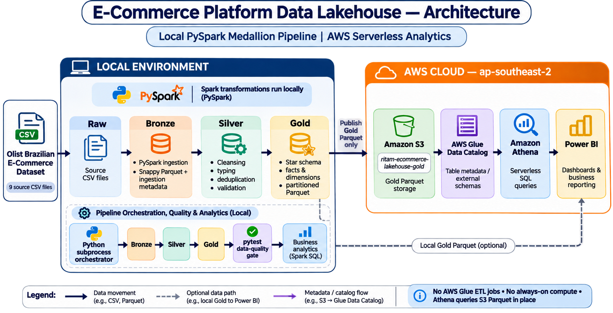

# E-Commerce Platform Data Lakehouse


An end-to-end data lakehouse for the [Olist Brazilian E-Commerce dataset](https://www.kaggle.com/datasets/olistbr/brazilian-ecommerce). The project uses PySpark to turn 100,000+ e-commerce orders into governed, analytics-ready Parquet tables, then exposes the Gold layer through Amazon S3, AWS Glue Data Catalog, Amazon Athena, and Power BI.

## Overview

The implementation follows the Medallion architecture: source CSV files are preserved in a Raw layer, converted to Bronze Parquet, cleansed and standardized in Silver, and modeled into Gold facts and dimensions. The result is a repeatable local processing workflow with a lightweight serverless query layer in AWS.

The cloud design deliberately separates transformation from serving. Spark processing runs locally, while only the optimized Gold tables are synchronized to S3. Athena provides on-demand SQL access without maintaining a database server or running AWS Glue ETL jobs, helping keep the cloud compute footprint at **$0 compute cost** for this architecture.

## Key concepts

This section explains the data-engineering terms used throughout the project.

| Concept | Plain-language explanation | How it is used here |
| --- | --- | --- |
| **Data lakehouse** | A data platform that combines the low-cost, flexible storage of a data lake with the organized, queryable tables associated with a data warehouse. | Local files and Amazon S3 store the data; Parquet tables, Athena SQL, and Power BI make it usable for analytics. |
| **Medallion architecture** | A staged approach to improving data quality as it moves from source files to reporting-ready tables. The stages are commonly named Bronze, Silver, and Gold. | The pipeline preserves source data first, then cleans it, then produces business-facing facts and dimensions. |
| **Raw layer** | An unchanged landing area for source files. Keeping it intact means the pipeline can be rerun and original values can be inspected. | The original Olist CSV files are stored in `data/raw/`. |
| **Bronze layer** | The first structured copy of raw data. It generally applies minimal transformation and records when the data was loaded. | CSV files are converted to compressed Parquet and assigned an ingestion timestamp. |
| **Silver layer** | Cleaned and standardized data that is suitable for reliable downstream processing. | The pipeline corrects data types, trims and standardizes text, removes duplicates, and filters invalid values. |
| **Gold layer** | Curated, business-ready tables designed for reporting, dashboards, and analytics. | Facts and dimensions such as `fact_orders` and `dim_customers` are produced for Athena and Power BI. |
| **Parquet** | A compressed, column-oriented file format. It is faster and less expensive to query than row-based CSV files for analytical workloads. | Bronze, Silver, and Gold tables are stored as Parquet files. |
| **Partitioning** | Organizing a large table into folders based on a commonly filtered field so queries read less data. | `fact_orders` is partitioned by purchase year and month. |
| **Star schema** | A reporting model with central event tables (facts) connected to descriptive lookup tables (dimensions). It makes dashboards easier to build and understand. | `fact_orders` connects order activity to customers, products, sellers, payments, and reviews. |
| **Fact table** | A table that records measurable business events, such as orders, payments, or order items. | `fact_orders`, `fact_payments`, and `fact_order_items` hold transactional measures. |
| **Dimension table** | A table that describes the people, products, places, or other categories used to group facts. | `dim_customers`, `dim_products`, and `dim_sellers` provide reporting context. |
| **ETL pipeline** | A repeatable process that extracts data from sources, transforms it into a usable form, and loads it into a destination. | PySpark scripts move data from Raw through Bronze and Silver to Gold. |
| **Amazon S3** | AWS object storage for files and datasets. | Optimized Gold Parquet files are published to S3 for cloud-based querying. |
| **AWS Glue Data Catalog** | A central catalog that stores table definitions and locations, rather than the data itself. | It records the schema and S3 paths that Athena needs to query the Gold data. |
| **Amazon Athena** | A serverless AWS service that runs SQL directly against files in S3. | It queries the Gold Parquet tables without a database server. |
| **Power BI and DAX** | Power BI is a business-intelligence tool for interactive reports; DAX is its formula language for measures such as revenue and order counts. | Power BI reads the Gold model and uses DAX to calculate dashboard metrics. |

### How the pieces fit together

1. Source CSV files enter the **Raw** layer.
2. PySpark converts them into **Bronze** Parquet files and records ingestion metadata.
3. PySpark cleans and validates the data in the **Silver** layer.
4. PySpark creates the **Gold** star schema for analysis.
5. Gold data is queried locally or published to **S3**, cataloged by **Glue**, and queried with **Athena**.
6. **Power BI** uses the Gold tables to deliver interactive business dashboards.

## Architecture



### Data flow

```text
Olist CSV files
    ↓
Raw layer (data/raw)
    ↓  PySpark ingestion + ingestion metadata
Bronze layer (Snappy-compressed Parquet)
    ↓  cleansing, validation, typing, and deduplication
Silver layer (conformed Parquet)
    ↓  dimensional modeling and partitioning
Gold layer (facts and dimensions)
    ↓
Amazon S3 → AWS Glue Data Catalog → Amazon Athena → Power BI
```

### The Medallion data pipeline

1. **Bronze layer — raw ingestion.** Reads the nine Olist source CSV files, adds ingestion metadata with `current_timestamp`, and writes Snappy-compressed Parquet. Overwrite-mode writes keep the stage idempotent for repeatable reruns.
2. **Silver layer — cleansing and conformance.** Applies data types, trims and standardizes text fields, removes duplicate records, and validates operational measures. Invalid mathematical values, such as negative item prices or freight, are excluded from analytics-ready output.
3. **Gold layer — star-schema modeling.** Produces business-facing fact and dimension tables for reporting and ad hoc SQL. Small lookup tables are suited to Spark broadcast joins, reducing shuffle overhead during local transformations.

`fact_orders` is partitioned by `purchase_year` and `purchase_month`. This layout lets Athena prune partitions when a query filters on those fields, lowering the volume of data scanned and improving query performance.

## Technology stack

| Area | Technology | Purpose |
| --- | --- | --- |
| Data processing | Python, Apache Spark (PySpark) | Ingestion, transformations, and analysis |
| Data quality | `pytest` | Automated integrity checks before publishing data |
| Data lake and metadata | Amazon S3, AWS Glue Data Catalog | Durable Gold storage and query metadata |
| Serverless SQL | Amazon Athena | SQL analytics directly over S3 Parquet files |
| Business intelligence | Power BI | Interactive reporting from local or cloud-hosted Gold data |
| Orchestration | Python `subprocess` controller | Ordered execution of pipeline stages |

## Repository structure

```text
ecommerce-data-lakehouse/
├── config/             # Path configuration shared by pipeline stages
├── data/               # Local Raw, Bronze, Silver, and Gold data; Gitignored
├── docs/               # Generated analytics reports and documentation images
├── scripts/            # Pipeline orchestration and S3 upload utilities
├── sql/                # Amazon Athena DDL schemas
├── src/
│   ├── analytics/      # Spark SQL business intelligence queries
│   ├── ingestion/      # CSV-to-Bronze Parquet ingestion
│   └── transformations/# Silver cleansing and Gold star-schema modeling
└── tests/              # Pytest data-quality assertions
```

## Gold data model

The Gold layer separates descriptive entities from transactional events so that dashboards can aggregate measures consistently.

| Table type | Tables | Primary analytical purpose |
| --- | --- | --- |
| Dimensions | `dim_customers`, `dim_sellers`, `dim_products` | Customer, seller, location, and product attributes |
| Facts | `fact_orders`, `fact_order_items`, `fact_payments`, `fact_reviews` | Order lifecycle, line items, payment activity, and customer feedback |

The model supports common e-commerce metrics such as monthly revenue, average order value (AOV), order growth, delivery performance, product performance, payment behavior, and geographic distribution.

## AWS cloud deployment

To avoid AWS Glue ETL DPU-hour charges, the compute-intensive processing stages remain local. The deployment process publishes the resulting Gold Parquet datasets to Amazon S3, where Athena can query them in place.

1. **S3 storage:** Upload Gold Parquet files to `s3://ritam-ecommerce-lakehouse-gold` in `ap-southeast-2`.
2. **Metadata and SQL access:** Run the statements in `sql/athena_ddl.sql` to create the `ecommerce_gold` database and its external-table definitions.
3. **Partition discovery:** After new `fact_orders` partitions are uploaded, run `MSCK REPAIR TABLE ecommerce_gold.fact_orders` in Athena to register them.
4. **Query efficiently:** Include `purchase_year` and `purchase_month` filters whenever practical so Athena scans only relevant partitions.

### Proof of cloud execution

* **Amazon Athena query execution:**
  
* **S3 bucket structure:**
  

## Run locally

### Prerequisites

Before running the pipeline, install Python 3.9 or later and a Java runtime compatible with PySpark. The source Olist CSV files are intentionally not versioned and must be supplied locally.

### Installation

1. Clone the repository and install dependencies:

   ```bash
   git clone [https://github.com/YOUR_USERNAME/ecommerce-data-lakehouse.git](https://github.com/YOUR_USERNAME/ecommerce-data-lakehouse.git)
   cd ecommerce-data-lakehouse
   python -m venv venv
   ```

2. Activate the virtual environment and install packages:

   ```powershell
   .\venv\Scripts\Activate.ps1
   pip install -r requirements.txt
   ```

3. Download the Olist dataset and place its CSV files in `data/raw/`.

### Execute the complete workflow

Run the controller from the repository root:

```bash
python scripts/run_pipeline.py
```

The controller runs the stages in dependency order: Bronze ingestion, Silver transformations, Gold modeling, data-quality tests, and business analytics. It stops immediately if a stage fails, preventing incomplete or invalid data from flowing into subsequent steps.

The generated analytics report is available at `docs/business_queries_report.txt` after a successful run.

### Run individual stages

Each stage can also be executed independently when developing or troubleshooting:

```bash
python src/ingestion/ingest_to_bronze.py
python src/transformations/process_silver.py
python src/transformations/process_gold.py
python -m pytest tests/test_data_quality.py -v --disable-warnings
python src/analytics/business_queries.py
```

## Data quality automation

`pytest` validations provide a quality gate between transformation and analytics. The checks focus on the integrity conditions most important to a dimensional reporting model:

* Primary-key uniqueness for fact-table records.
* Referential integrity checks using left anti-joins to identify orphaned foreign keys between facts and dimensions.
* Validation that revenue-related and freight values are not negative.
* Repeatable execution that makes failures visible in local development and automated runs.

These checks do not replace source-system governance, but they make quality assumptions explicit and help prevent flawed records from reaching Athena or Power BI.

## Business intelligence with Power BI

The Power BI report turns the Gold layer into an interactive decision-support experience across commercial performance, product and seller outcomes, and customer experience.

### Data ingestion and transformation

Power BI uses the **Folder** connector to batch-load seven local Gold-layer Parquet tables produced by the PySpark lakehouse. In Power Query, the `Extension` column is filtered to exclude hidden `.crc` files and `(blank)` values before binaries are combined.

### Data model

`fact_orders` is the central hub of the one-to-many star schema. The following relationships connect dimensions and related facts:

| From | To | Key |
| --- | --- | --- |
| `dim_customers` | `fact_orders` | `customer_id` |
| `fact_orders` | `fact_order_items` | `order_id` |
| `dim_products` | `fact_order_items` | `product_id` |
| `dim_sellers` | `fact_order_items` | `seller_id` |
| `fact_orders` | `fact_payments` | `order_id` |
| `fact_orders` | `fact_reviews` | `order_id` |

To make customer states resolve correctly in the map visual, `dim_customers` includes this calculated column:

```DAX
State Location = dim_customers[customer_state] & ", Brazil"
```

### DAX measures

```DAX
Total Orders = DISTINCTCOUNT(fact_orders[order_id])
Total Revenue = SUM(fact_payments[payment_value])
Average Order Value = [Total Revenue] / [Total Orders]
Average Review Score = AVERAGE(fact_reviews[review_score])
Average Freight = AVERAGE(fact_order_items[freight_value])
Product Revenue = SUM(fact_order_items[price])
Items Sold = COUNT(fact_order_items[order_item_id])
Total Reviews = COUNT(fact_reviews[review_id])
Delivery Time (Days) = AVERAGEX(fact_orders, DATEDIFF(fact_orders[order_approved_at], fact_orders[order_delivered_customer_date], DAY))
```

### Dashboard pages

#### Page 1 — Executive Summary

* KPI cards for Total Revenue, Total Orders, and Average Order Value, with monetary measures formatted as currency.
* Monthly Revenue Trend line chart using `purchase_year` and `purchase_month` on the X-axis and Total Revenue on the Y-axis; incomplete September 2018 data is excluded.
* Order Fulfillment Status donut chart using `order_status` and Total Orders.
* Date slicer displayed as tiles.

<p align="center">
  
</p>

#### Page 2 — Product & Seller Performance

* Top 10 Categories by Revenue stacked bar chart, filtered to the top 10 `product_category` values by Product Revenue.
* Top Sellers matrix with `seller_id`, Product Revenue, and Items Sold.
* Profitability vs. Logistics scatter plot: Product Revenue on the X-axis, Average Freight on the Y-axis, grouped by `product_category`.
* Product Category dropdown slicer.

<p align="center">
  
</p>

#### Page 3 — Customer Experience

* KPI cards for Average Review Score and Delivery Time (Days), each displayed to one decimal place.
* Regional Order Volume map using State Location and Total Orders for bubble size.
* Logistics Bottlenecks stacked bar chart showing Delivery Time (Days) by `customer_state`.
* Review Score Distribution stacked column chart using `review_score` and Total Reviews.
* Review Score slicer displayed as tiles.

<p align="center">
  
</p>
